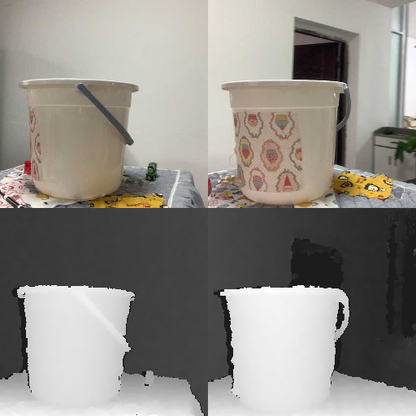
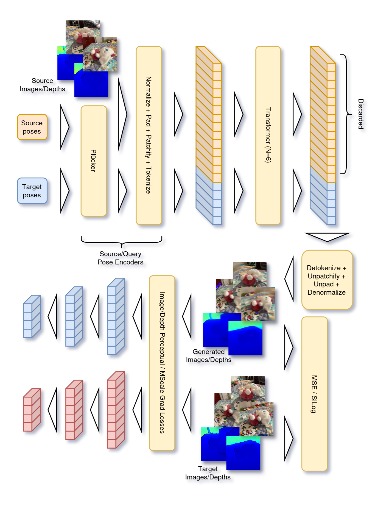

# View-Depth Synthesis Transformer: A Transformer-based Model for RGB-D Novel View Synthesis

| English | [Português](README_PT.md) |

This is the implementation of the VDST model, together with code to train it with the datasets originally used.

It is an RGB-D Novel View Synthesis model, where given a set of images and depths from a 3D scene with their respective camera properties/poses,
the model aims to generate a new view/depth in the scene, given the camera properties and pose of the target view.

This model was inspired primarily by the architecture and phylosophy of [LVSM](https://haian-jin.github.io/projects/LVSM/),
where it applies its same core idea to the task of RGB-D Novel View Synthesis.

### Rendered scene example

Rendered scene:

<https://github.com/user-attachments/assets/35a33c5e-fd6a-473b-b55a-ea6f4a667a93>

Source images:



### Architecture



#### Process

Inputs:
- Images $I_k \in [0, 1]^{3 \times W \times H}$;
- Depth maps $D_k \in \mathbb{R}_+^{W \times H}$;
- Depth masks $M_k \in \{ 0, 1 \}^{W \times H}$;
- Intrinsic matrices $K_k \in \mathbb{R}^{3 \times 3}$;
- Extrinsic matrices $E_k \in \mathbb{R}^{4 \times 4}$;

Outputs:
- Target image $I_{\mathrm{target}} \in [0, 1]^{3 \times W \times H}$;
- Target depth map $D_{\mathrm{target}} \in \mathbb{R}_+^{W \times H}$;

The target images are given by:

$$
\begin{align}
[I_k, D_k] &= \left[\frac{I_{k, \mathrm{raw}} - i_{\mu}}{i_{\sigma} + \varepsilon}, \frac{\log(D_{k, \mathrm{raw}} + \varepsilon) - d_{\mu}}{d_{\sigma} + \varepsilon} \right] & \text{ (normalized sources)} \\
\begin{bmatrix} R_k & \mathbf{t}_k \\ 0 & 1 \end{bmatrix} &= E_k & \text{ (rotation/translation)} \\
\mathbf{v}_{ij} &= [i + 0.5, j + 0.5, 1] & \text{ (raw pixel center vectors)} \\
[\mathbf{o}_{k, ij}, \mathbf{d}_{k, ij}] &= [\mathbf{t}_k, R_k K_k^{-1} \mathbf{v}_{ij}] & \text{ (inverse projection (c2w))} \\
O_{k, ij} &= [\mathbf{d}_{k, ij}, \mathbf{o}_{k, ij} \times \mathbf{d}_{k, ij}] & \text{ (Plücker embedding)} \\
\mathrm{Tokenize}(P) &= P W_{P} + b_P & \text{ (linearly maps to tokens)} \\
X &= \mathrm{Tokenize}(\mathrm{Patchify}([[O_1, I_1, D_1], \dots, [O_N, I_N, D_N]])) & \text{ (concat, patchify and tokenize sources)} \\
Q &= \mathrm{Tokenize}(\mathrm{Patchify}([O_1, \dots, O_N])) & \text{ (concat, patchify and tokenize queries)} \\
[X_{discard}, Y] &= \mathrm{Transformer}([X, Q]) & \text{ (output tokens)} \\
[I_{\mathrm{target}, \mathrm{raw}}, D_{\mathrm{target}, \mathrm{raw}}] &= \mathrm{Depatchify}(\mathrm{Detokenize}(Y)) & \text{ (normalized targets)} \\
[I_{\mathrm{target}}, D_{\mathrm{target}}] &= [i_{\sigma} I_{\mathrm{target}, \mathrm{raw}} + i_{\mu}, e^{d_{\sigma} D_{\mathrm{target}, \mathrm{raw}} + d_{\mu}}] & \text{ (denormalized targets)}. \\
\end{align}
$$

The loss is given by:

$$
\begin{align}
\mathcal{L}([I_{\mathrm{target}}, D_{\mathrm{target}}], [\hat{I}_{\mathrm{target}}, \hat{D}_{\mathrm{target}}]) &= \mathcal{L}_I(I_{\mathrm{target}}, \hat{I}_{\mathrm{target}}) + \mathcal{L}_D(D_{\mathrm{target}}, \hat{D}_{\mathrm{target}}) \\
\mathcal{L}_{I}(I, \hat{I}) &= \lambda_{I, \mathrm{MSE}} \mathcal{L}_{I, \mathrm{MSE}}(I, \hat{I}) + \lambda_{I, \mathrm{Percep}} \mathcal{L}_{I, \mathrm{Percep}}(I, \hat{I}) \\
\mathcal{L}_{D}(D, \hat{D}) &= \lambda_{D, \mathrm{SILog}} \mathcal{L}_{D, \mathrm{SILog}}(D, \hat{D}) + \lambda_{D, \mathrm{grad}} \mathcal{L}_{D, \mathrm{grad}}(D, \hat{D}) + \lambda_{D, \mathrm{Percep}} \mathcal{L}_{D, \mathrm{Percep}}(D, \hat{D}) \\
\mathcal{L}_{I, \mathrm{MSE}}(I, \hat{I}) &= \mathrm{MSE}(I, \hat{I}) \\
\mathcal{L}_{I, \mathrm{Percep}}(I, \hat{I}) &= \frac{1}{N_{\mathrm{layers}} C_l H_l W_l} \sum_{l = 1}^{N_{\mathrm{layers}}} \lambda_l \left\| \phi_l\left( \frac{I - \mu_I}{\sigma_I} \right) - \phi_l\left( \frac{\hat{I} - \mu_I}{\sigma_I} \right) \right\|_1 \\
\mathcal{L}_{D, \mathrm{SILog}}(D, \hat{D}) &= \mathrm{MSE}(\log(D), \log(\hat{D})) - \lambda \mathrm{ME}(\log(D), \log(\hat{D}))^2 \\
\mathcal{L}_{D, \mathrm{Grad}}(D, \hat{D}) &= \frac{1}{N_{\mathrm{scale}} C_l H_l W_l} \sum_{l = 1}^{N_{\mathrm{scale}}} |\nabla_X (D_l - \hat{D}_l)| + |\nabla_Y (D_l - \hat{D}_l)| \\
\mathcal{L}_{D, \mathrm{Percep}}(D, \hat{D}) &= \mathcal{L}_{I, \mathrm{Percep}} \left( \frac{\log(D) - \log(\hat{D})}{\sqrt{2} \sigma_{\log, D}}, \mathbf{0} \right), \\
\end{align}
$$

where $\mu_{D, Percep} = \mu_{\log, D} - \mu_{\log, D} = 0$, $\sigma_{D, Percep} = \sqrt{\sigma^2_{\log, D} + \sigma^2_{\log, D}} = \sqrt{2} \sigma_{\log, D}$, and $\mu_I, \sigma_I, \mu_{\log, D}, \sigma_{\log, D}$ are the means and stds for images and log-depths computed for the entire dataset.

### Results

Here are some of the results from the model after trained with batch size 4 for 350000 iterations with an RTX 4060 Ti with 8GB VRAM, which took around 153 hours.

Number of parameters: 43.46M.

Metrics:

- Image:
  - PSNR: 19.72
  - SSIM: 0.588
  - LPIPS: 0.424
- Depth:
  - AbsRel: 0.0401
  - RMSE: 0.168
  - $\delta_{1}$: 0.971

Validation Set:


Test set:


Test new category set (`truck` category):


### Contributions and limitations

Main contributions:

- The architecture (VDST);
- A variation of perceptual loss using ConvNeXt instead of VGG-19;
- A perceptual loss for depth maps based in ConvNeXt with a second CNN specific for estimating the receptive field and allow using masks of invalid values in the loss latents;
- A processing pipeline for datasets of RGB-D scenes that allows isolating the evaluation of content generation and view interpolation in the new generated views.

Main advantages this model has in comparison to other methods for RGB-D NVS:

- Due to the generalization ability of Transformer-based models across domains, it is capable of:
  - Generalizing to novel scenes that follow a similar distribution to the original training data;
  - Doing few-shot NVS, needing only two source images or even just a single one in most cases for generating new views;
- Following the same approach as LVSM, our architecture also tries to minimize the inductive bias of the model,
  and we hypothesize that this allows it to achieve better results than other methods when trained for longer periods with sufficiently large amounts of data,
  although we do not have enough computational resources to verify this, leaving it for future work;
- It can be trained under constrained resources without diverging (the author used a single RTX 4060 Ti with 8GB VRAM).

Main limitation of this model:
This model was trained under heavy resource constraints, where, as stated before, we only had a single NVIDIA RTX 4060 Ti 8GB VRAM to train the model, an environment more constrained even than that of other generalizable joint view and depth synthesis models trained under resource constraints, which commonly use one NVIDIA A100 80GB VRAM or similar.
This forced us to use a way smaller model in comparison to others (our model has 43.5M parameters, while other models like [LVSM](https://haian-jin.github.io/projects/LVSM/) or [MVGD](https://mvgd.github.io/) have around 400-600M parameters), and prevented us from training the model until convergence, which causes it to still have some visual artifacts.

## Inference

The trained model weights can be found [here](https://huggingface.co/gammag7/vdst).

We also made a renderer that you can use to navigate on the scenes using this model, you can check it out [here](https://github.com/gammag4/nvs_renderer).

## Dataset

A script for downloading and processing the WildRGB-D dataset can be found [here](https://github.com/gammag4/nvs_datasets).

The dataset was divided in four sets:

- `train`: For training the model;
- `val`: For evaluating the metrics during and at the end of training of the experiments and for choosing the best one;
- `test`: For evaluating the metrics of the final trained model in new scenes unseen in the training and validation sets;
- `test_new_category`: For evaluating the metrics of the final trained model in scenes from a new category unseen during training.

The results from the three validation/test sets chosen are in the folder `final_results`, whoose results are separated in the following files:

- `scenes.yaml`: Scenes used on the quantitative evaluation of that set;
- `scenes_rendered.yaml`: Scenes chosen from that set to be rendered and used in qualitative evaluation;
- `sources_n_val.png`: Source images from batch n used for qualitative analysis, whoose images are specified by `scenes_rendered.yaml`;
- `targets_0_val.png`: Target images generated by the model for the batch n used for qualitative analysis, whoose images are specified by `scenes_rendered.yaml`;
- `eval_metrics.yaml`: Final quantitative evaluation metrics (`snr_log` and `sqrt_snr_log` are just for debug, they are not real metrics).

## Training

### Requirements

You need:

- Some conda distribution (we recommend using [Miniforge](https://conda-forge.org/download/))
- NVIDIA drivers that support CUDA >= 13.0

### Downloading and processing datasets

Download and process the WildRGB-D dataset using the script provided to the folder `datasets/wildrgbd`.

### Creating environment

Create the Python environment and install dependencies:

```sh
conda create -n vdst python=3.13
conda activate vdst
pip install -r requirements.txt
```

### Training the model

Run the train script:

```bash
torchrun --standalone --nproc-per-node=gpu train.py --config config.yaml
```
